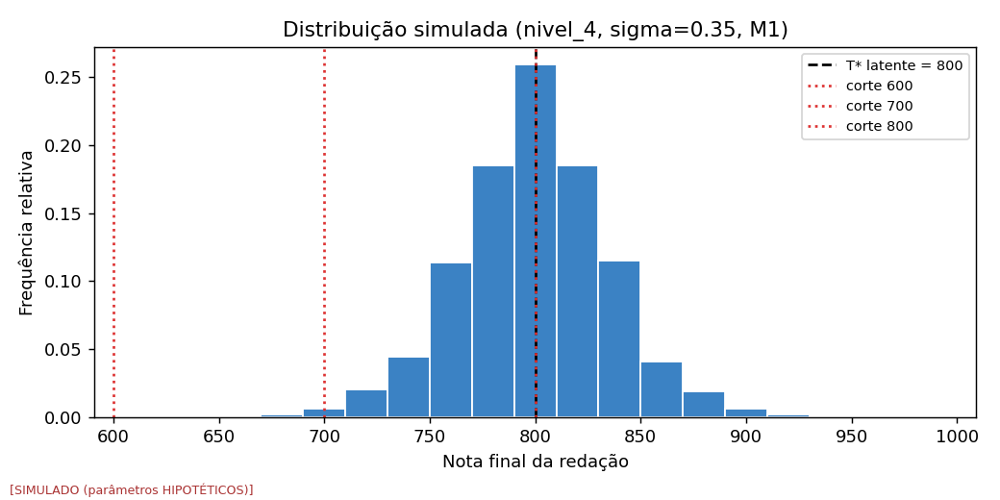
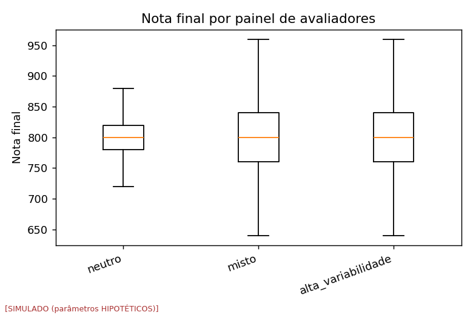
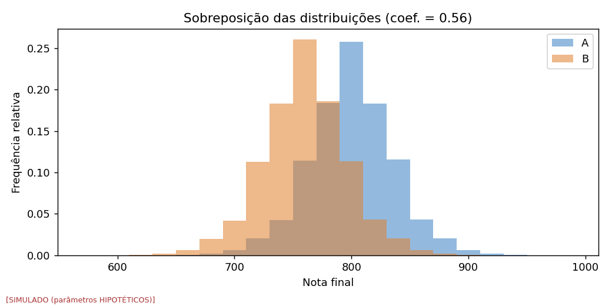
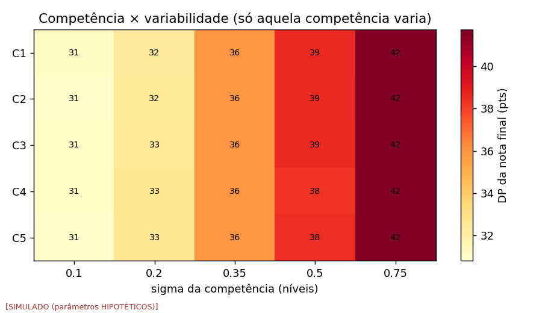

> **Atenção:** todos os números abaixo são **SIMULADOS** e dependem de parâmetros **HIPOTÉTICOS**. Não constituem evidência empírica sobre o ENEM real. Valem como mapa condicional às premissas listadas.

## 1. Observação (contexto; nenhum dado real usado)

Cada competência é avaliada em 6 níveis (0–200, passo 40); duas avaliações independentes são consolidadas pela regra 2025 (fontes secundárias; confirmar na Cartilha). Não há notas por avaliador públicas para calibrar sigma.

## 2. Hipóteses e critérios (fixados antes da execução)

H0: DP < 40 pts **e** P(|nota − E[nota]| ≥ 40) < 5%.  
H1: caso contrário. Limiares HIPOTÉTICOS (`config.yaml`).

## 3. Simulação

120 células na fase 1 × 100,000 iterações; modelos ['M0', 'M1']; painéis ['neutro', 'misto', 'alta_variabilidade']; sigma ∈ [0.1, 0.2, 0.35, 0.5, 0.75]; sigma_u ∈ [0.0, 0.15].  
Manifesto:

```
experiment: exp001_single_essay
seed: 20261007
iterations: 100000
model_version: enemnoise-model-0.1.0
data_version: simulated-v0
timestamp_utc: 2026-10-07T19:18:12.449857+00:00
config_hash: 4c7ace7790f923289bdf0233cec7a0f10d201d629d522ceadfbb26e1d936f495
numpy: 2.4.4
python: 3.12.3
```

## 4. Resultado

**H1 satisfeito em 104 de 120 células (87%); H0 em 16.**

Resumo por modelo e sigma:

| model | sigma | dp_medio | p_terceiro_medio | frac_H1 |
|---|---|---|---|---|
| M0 | 0.100 | 35.037 | 0.142 | 0.667 |
| M0 | 0.200 | 38.644 | 0.161 | 0.833 |
| M0 | 0.350 | 46.222 | 0.234 | 1.000 |
| M0 | 0.500 | 53.874 | 0.351 | 1.000 |
| M0 | 0.750 | 65.357 | 0.567 | 1.000 |
| M1 | 0.100 | 14.060 | 0.063 | 0.333 |
| M1 | 0.200 | 28.827 | 0.118 | 0.833 |
| M1 | 0.350 | 47.064 | 0.242 | 1.000 |
| M1 | 0.500 | 57.767 | 0.346 | 1.000 |
| M1 | 0.750 | 69.893 | 0.502 | 1.000 |

Sigma crítico (menor sigma da grade com H1):

| model | panel | sigma_u | essay | sigma_critico |
|---|---|---|---|---|
| M0 | alta_variabilidade | 0.000 | nivel_3 | 0.200 |
| M0 | alta_variabilidade | 0.000 | nivel_4 | 0.200 |
| M0 | alta_variabilidade | 0.150 | nivel_3 | 0.100 |
| M0 | alta_variabilidade | 0.150 | nivel_4 | 0.100 |
| M0 | misto | 0.000 | nivel_3 | 0.100 |
| M0 | misto | 0.000 | nivel_4 | 0.100 |
| M0 | misto | 0.150 | nivel_3 | 0.100 |
| M0 | misto | 0.150 | nivel_4 | 0.100 |
| M0 | neutro | 0.000 | nivel_3 | 0.350 |
| M0 | neutro | 0.000 | nivel_4 | 0.350 |
| M0 | neutro | 0.150 | nivel_3 | 0.100 |
| M0 | neutro | 0.150 | nivel_4 | 0.100 |
| M1 | alta_variabilidade | 0.000 | nivel_3 | 0.200 |
| M1 | alta_variabilidade | 0.000 | nivel_4 | 0.200 |
| M1 | alta_variabilidade | 0.150 | nivel_3 | 0.200 |
| M1 | alta_variabilidade | 0.150 | nivel_4 | 0.200 |
| M1 | misto | 0.000 | nivel_3 | 0.100 |
| M1 | misto | 0.000 | nivel_4 | 0.100 |
| M1 | misto | 0.150 | nivel_3 | 0.100 |
| M1 | misto | 0.150 | nivel_4 | 0.100 |
| M1 | neutro | 0.000 | nivel_3 | 0.350 |
| M1 | neutro | 0.000 | nivel_4 | 0.350 |
| M1 | neutro | 0.150 | nivel_3 | 0.200 |
| M1 | neutro | 0.150 | nivel_4 | 0.200 |

Fase 2 — A=[4,4,4,4,4] vs B=[4,4,3,4,4] (diferença latente de 40 pts):

| model | sigma | P_A_gt_B | P_empate | P_inversao | sobreposicao |
|---|---|---|---|---|---|
| M0 | 0.100 | 0.830 | 0.000 | 0.170 | 0.463 |
| M0 | 0.200 | 0.796 | 0.000 | 0.204 | 0.539 |
| M0 | 0.350 | 0.742 | 0.000 | 0.258 | 0.650 |
| M0 | 0.500 | 0.705 | 0.000 | 0.295 | 0.716 |
| M0 | 0.750 | 0.670 | 0.000 | 0.330 | 0.762 |
| M1 | 0.100 | 0.941 | 0.039 | 0.020 | 0.127 |
| M1 | 0.200 | 0.813 | 0.090 | 0.097 | 0.397 |
| M1 | 0.350 | 0.687 | 0.099 | 0.213 | 0.648 |
| M1 | 0.500 | 0.646 | 0.088 | 0.266 | 0.732 |
| M1 | 0.750 | 0.617 | 0.080 | 0.302 | 0.779 |

Fase 3 — P(nota = 1000 | desempenho latente), M1:

| panel | sigma | 4.5 | 4.75 | 5.0 |
|---|---|---|---|---|
| alta_variabilidade | 0.1000 | 0.0707 | 0.4677 | 0.8770 |
| alta_variabilidade | 0.2000 | 0.0159 | 0.1487 | 0.4865 |
| alta_variabilidade | 0.3500 | 0.0055 | 0.0420 | 0.1583 |
| alta_variabilidade | 0.5000 | 0.0045 | 0.0214 | 0.0726 |
| alta_variabilidade | 0.7500 | 0.0077 | 0.0189 | 0.0424 |
| misto | 0.1000 | 0.3575 | 0.5622 | 0.7986 |
| misto | 0.2000 | 0.1999 | 0.4183 | 0.6090 |
| misto | 0.3500 | 0.0707 | 0.2265 | 0.4073 |
| misto | 0.5000 | 0.0315 | 0.1131 | 0.2523 |
| misto | 0.7500 | 0.0138 | 0.0478 | 0.1170 |
| neutro | 0.1000 | 0.1498 | 0.6753 | 0.9605 |
| neutro | 0.2000 | 0.0457 | 0.3499 | 0.7910 |
| neutro | 0.3500 | 0.0129 | 0.1208 | 0.4208 |
| neutro | 0.5000 | 0.0065 | 0.0541 | 0.2041 |
| neutro | 0.7500 | 0.0043 | 0.0239 | 0.0833 |






## 5. Evidências contrárias à hipótese principal (H0)

16 células satisfazem H0 (variabilidade irrelevante pelo critério pré-fixado). Menores sigma: [0.1, 0.2]. Ver `grid.csv`.

## 6. Interpretação (condicional)

A discrepância relevante aparece **a partir de certo sigma**; abaixo dele, não. Este experimento não diz qual é o sigma real. A decisão sobre se a nota é 'estável o bastante' exige calibrar sigma (notas por avaliador ou taxa real de terceiro corretor) — ver exp003 e `docs/DADOS_NECESSARIOS.md`. Diferenças entre M0 e M1 indicam o quanto a discretização importa.
