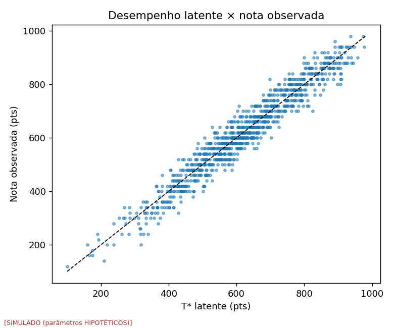
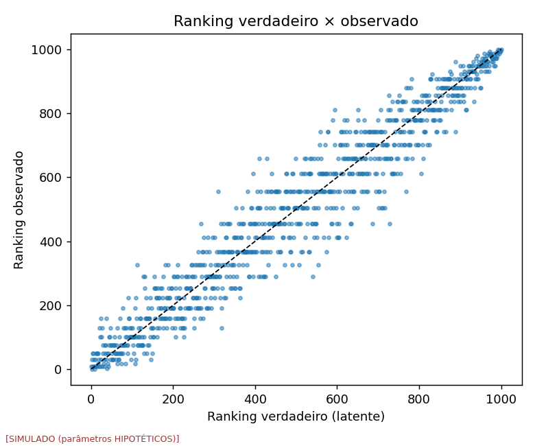
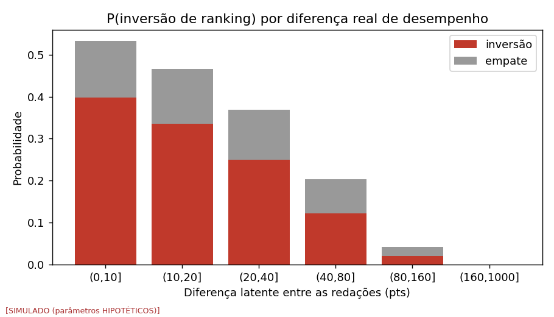

> **Atenção:** todos os números abaixo são **SIMULADOS** e dependem de parâmetros **HIPOTÉTICOS**. Não constituem evidência empírica sobre o ENEM real. Valem como mapa condicional às premissas listadas.

## 1. Pergunta

Qual a probabilidade de a ordenação pelas notas diferir da ordenação latente apenas pela variabilidade de avaliação?

## 2. Simulação

População HIPOTÉTICA (mu=[3.2, 3.2, 3.0, 3.0, 3.0], tau=0.9, rho=0.7); 50 replicações; tamanhos [10, 100, 1000].

```
experiment: exp002_ranking
seed: 20261008
iterations: 50
model_version: enemnoise-model-0.1.0
data_version: simulated-v0
timestamp_utc: 2026-10-07T19:18:15.166401+00:00
config_hash: d81d4c416eb44f1196284f587f9da4ab322b8af4aa53dd53c6c1c5b1ba79e937
numpy: 2.4.4
python: 3.12.3
```

## 3. Resultado

| sigma | M | spearman | kendall | desloc_medio_rank | P(inversao) | P(empate) | P(inv)_so_discretizacao | troca_no_topo |
|---|---|---|---|---|---|---|---|---|
| 0.2000 | 10 | 0.9458 | 0.8800 | 0.5420 | 0.0507 | 0.0333 | 0.0000 | 0.0000 |
| 0.2000 | 100 | 0.9571 | 0.8451 | 6.2072 | 0.0657 | 0.0408 | 0.0329 | 0.1650 |
| 0.2000 | 1000 | 0.9723 | 0.8698 | 50.9349 | 0.0555 | 0.0342 | 0.0219 | 0.1212 |
| 0.3500 | 10 | 0.9332 | 0.8568 | 0.6160 | 0.0613 | 0.0364 | 0.0000 | 0.0100 |
| 0.3500 | 100 | 0.9461 | 0.8224 | 6.9738 | 0.0770 | 0.0403 | 0.0329 | 0.1900 |
| 0.3500 | 1000 | 0.9652 | 0.8516 | 57.2839 | 0.0645 | 0.0341 | 0.0219 | 0.1392 |
| 0.6000 | 10 | 0.9098 | 0.8130 | 0.7800 | 0.0827 | 0.0369 | 0.0000 | 0.0400 |
| 0.6000 | 100 | 0.9156 | 0.7696 | 8.8340 | 0.1032 | 0.0394 | 0.0329 | 0.2500 |
| 0.6000 | 1000 | 0.9439 | 0.8065 | 73.2169 | 0.0866 | 0.0341 | 0.0219 | 0.1785 |





`P(inv)_so_discretizacao`: inversões que ocorreriam mesmo com avaliadores perfeitos e sem ruído, apenas porque a nota só assume 6 níveis por competência (efeito da ESCALA, não do avaliador). `P(inversao)`: fração de pares (a,b) com T*_a > T*_b em que a nota observada de a é MENOR que a de b. `troca_no_topo`: fração do grupo 'top 20%' (pela ordem latente) substituída por outros candidatos.

## 4. Interpretação (condicional)

Spearman alto convive com muitas inversões locais entre candidatos próximos. A curva de inversão por diferença latente (figura) mostra onde a nota deixa de discriminar. Nada aqui informa o sigma real do ENEM.
